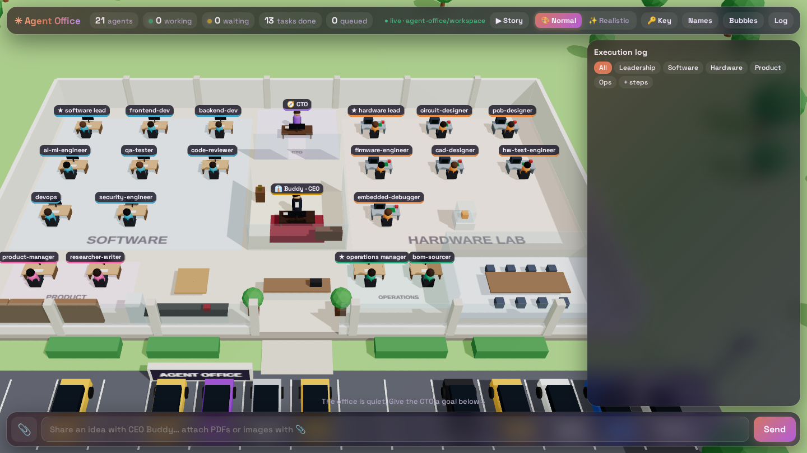
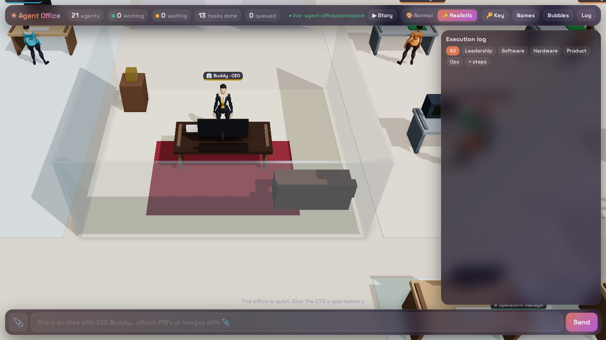
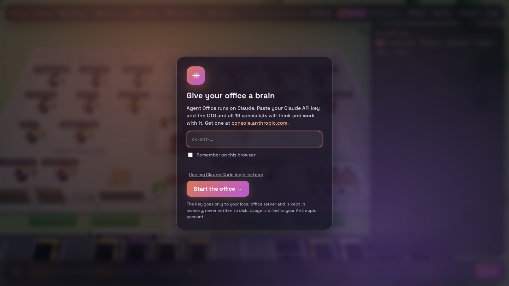

# Agent Office

Open source (MIT). A CTO and 19 AI specialists, powered by Claude, doing real work in a live 3D office.



| ✨ Realistic mode: animated, dressed 3D people | First run: paste your Claude API key |
|---|---|
|  |  |

## Quick start

```bash
git clone <this repo> && cd agent-office
uv run office.py          # then open http://localhost:8765
```

On first open, a popup asks for your **Claude API key** ([get one](https://console.anthropic.com/settings/keys)). It is sent only to your local server and kept in memory, never written to disk; tick "Remember" to keep it in your browser. Change it any time with **🔑 Key**. You can also set `ANTHROPIC_API_KEY` in the environment, or skip the popup to use an existing Claude Code login. Requires Python 3.13+, [uv](https://docs.astral.sh/uv/) and Node (for the Claude Code CLI the agent SDK runs).

An AI office: a **CTO** that plans goals and hands the work to 19 specialists: a software team, a hardware lab, product & research, and operations (an Operations Manager and a parts sourcer). Buddy is the CEO. They do real work (code, firmware, BOMs, CAD, test plans) in a project folder.

```bash
uv run office.py                                           # then open http://localhost:8765
uv run office.py "add a temp sensor to Buddy" --project ../desktop-buddy
uv run office.py "..." --once                              # one goal, then exit (scripts)
```

**3D office** (`viewer/index.html`, three.js): every agent has a desk. Agents bounce with a green ring while working; a yellow ring and "needs your OK" mean waiting. Envelopes fly between desks on hand-offs. The top bar shows live counts, and the execution log can be filtered by team. Click an agent for its card and recent activity, and to message it (through the CTO). Risky actions pop up an **Approve / Deny** card. You can type goals and answers in the terminal or the browser.

- **Graphics switch (🎨 Normal | ✨ Realistic):** Realistic mode swaps the figures for rigged, animated 3D people (three.js's open-source Mixamo "Xbot", dressed by team: coloured shirts, suits and ties for the CTO and CEO) at standing desks. They idle, nod while working and walk. Open `http://localhost:8765/?real` to jump straight in.
- **▶ Story / ■ Exit story:** a scripted demo sprint with captions, for videos; click again to return to the live office.
- **Realistic graphics details:** top-bar toggle adding reflections, ambient occlusion, bloom and 8K soft shadows. Minimum 4-core CPU, 8 GB RAM, Intel Iris Xe / Apple M1 (2 GB VRAM); recommended 6+ cores, 16 GB, GTX 1660 / RX 6600 / Apple M2 (4 GB+ VRAM). The popup shows your own device specs before you switch.
- **Make it yours** (optional environment variables): `OFFICE_FOUNDER` (your name, used in the agents' instructions; default "the founder"), `OFFICE_REGION` (where you buy parts, e.g. `"India, prices in ₹"`), `OFFICE_NOTES` (a folder of notes the team may read). Example: `OFFICE_FOUNDER=Asha OFFICE_REGION="Germany, prices in €" uv run office.py`
- **Remote hardware tools (optional):** `bin/laptop` runs CAD/firmware tools on another machine over SSH; set `LAPTOP=user@host` or write it to `~/.config/agent-office/laptop`.
- **Roster:** `roster.py` (edit a role's tools or instructions there)
- **Live log:** printed in the terminal + `state/events.jsonl` (GOAL / SEND / START / STEP / ASK / APPROVE / DENY / DONE)
- **Desk status:** `state/board.json`, one entry per agent (idle / working / waiting, current task, tasks done)
- **Approvals:** reads, web searches and edits inside the project folder run freely. Any other shell command (installing, flashing, pushing, `rm`, redirects) and any write outside the project folder stops and asks you `[y/N]`.
- **Default project folder:** `workspace/`
- **Model:** Claude Opus 5, using the API key from the popup / `ANTHROPIC_API_KEY`, or your Claude Code login

**Buddy** (desktop-buddy) is the voice front door: "Hey Buddy, ask the office to…" hands over a goal (and starts the office if it is off), "how is the office doing?" reads its status, and Buddy announces when a job finishes or an agent needs your OK (spoken + a desktop notification with Approve / Deny buttons). Started this way, output goes to `office.log`.
